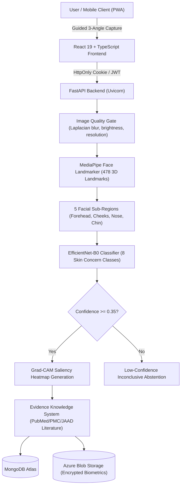

# DermaLens — Face Skin Assessment System

[](https://github.com/adi-jaybhaye/DermaLens/actions/workflows/ci.yml)
[](https://fastapi.tiangolo.com)
[](https://react.dev)
[](https://pytorch.org)
[](https://www.typescriptlang.org)

**DermaLens** is a full-stack, privacy-first facial skin assessment and wellness analysis platform. It combines guided multi-angle consumer photography, MediaPipe facial landmark localization, EfficientNet-B0 transfer learning, Explainable AI (Grad-CAM saliency heatmaps), and a curated dermatological evidence knowledge layer.

---

## Architecture Overview



---

## 8 Recognized Visual Skin Concern Classes

DermaLens predicts visible surface patterns across 8 distinct skin concerns:
1. **Redness** (Erythema / Flushing)
2. **Dark Spots** (Hyperpigmented macules)
3. **Inflammatory Acne** (Papules, Pustules)
4. **Non-Inflammatory Acne — Blackheads** (Open Comedones)
5. **Non-Inflammatory Acne — Whiteheads** (Closed Comedones)
6. **Pigmentation** (Melasma / Uneven Tone)
7. **Pores** (Visible follicular openings)
8. **Wrinkles** (Fine expression lines)

---

## Scientific Grounding & Academic Precision

- **Model Benchmark:** EfficientNet-B0 achieves **92.89% validation accuracy** on a deterministic 20% random validation split (seed 42, N=844 images) of the skin concerns training dataset (4,222 total images).
- **Academic Honesty Notice:** This metric reflects validation accuracy on the training split only. It must **never** be cited as clinical accuracy, real-world population diagnostic accuracy, or dermatologist-level performance.
- **Regional Inference:** Facial crops represent prototype visual localization inference, not independently validated per-region medical benchmarks.
- **Skin Type Grounding:** The system explicitly reports skin-type classification as **Unavailable** because optical 2D smartphone photography cannot replace physical biophysical contact instrumentation (e.g., Sebumeter, Corneometer).

---

## Security & Privacy Architecture

- **Authentication & Sessions:** Argon2id password hashing, `HttpOnly`, `SameSite=Lax`, and `Secure` session cookies (`derma_session`) with dual Bearer token support. Zero raw authentication tokens stored in client `localStorage`.
- **Private Object Storage:** Dedicated Azure Blob Storage integration with fail-fast validation in production; zero biometric data leaked to local container filesystem.
- **Strict Anti-Caching:** `Cache-Control: private, no-store, must-revalidate` enforced on all authenticated profile, assessment, and XAI endpoints.
- **Monotonic Assessment Sequencing:** Atomic sequence counter via MongoDB (`user_assessment_sequences`) prevents numbering race conditions under concurrency and ensures unique names even after deletions.
- **Protected XAI Endpoints:** Grad-CAM inferencing is protected behind authentication and rate limiting to prevent denial-of-service abuse.
- **Single-Face Constraint:** MediaPipe landmark detector enforces a strict single-face constraint, rejecting background faces or non-facial imagery.

---

## Project Structure

```
.
├── .github/workflows/ci.yml       # Production GitHub Actions CI/CD Pipeline
├── backend/
│   ├── app/
│   │   ├── api/                   # FastAPI routes (auth, assessments, images, xai, etc.)
│   │   ├── config/                # Settings, database connection & indexes
│   │   ├── ml/                    # ML pipeline (quality, face landmarker, EfficientNet, Grad-CAM)
│   │   ├── schemas/               # Pydantic request/response models
│   │   ├── services/              # Business logic (assessment, auth, knowledge, storage)
│   │   └── utils/                 # Rate limiting, security helpers
│   ├── frontend/                  # React 19 + TypeScript + Vite + PWA
│   ├── models/                    # EfficientNet-B0 checkpoint & MediaPipe task file
│   ├── tests/                     # 45 automated pytest tests
│   ├── Dockerfile                 # Production multi-stage Docker build
│   ├── requirements.txt           # Python dependencies
│   └── AZURE_DEPLOYMENT.md        # Comprehensive Azure deployment guide
└── README.md
```

---

## Local Development & Testing

### 1. Backend Setup
```powershell
cd backend
python -m venv venv
.\venv\Scripts\Activate.ps1
pip install torch torchvision --index-url https://download.pytorch.org/whl/cpu
pip install -r requirements.txt
uvicorn app.main:app --reload --port 8000
```
- API Docs: `http://localhost:8000/docs`
- Health: `http://localhost:8000/api/v1/health`

### 2. Frontend Setup
```powershell
cd backend/frontend
npm ci
npm run dev
```
- Frontend UI: `http://localhost:5173`

### 3. Running the Test Suite
```powershell
cd backend
.\venv\Scripts\pytest -o pythonpath=. tests/ -v
```
All 45 automated tests pass with 100% success rate.

---

## Production Deployment

- **Backend:** Azure App Service (Linux Container) at `https://dermalens-backend.azurewebsites.net`.
- **Frontend:** Vercel with Root Directory set to `backend/frontend`.
- **Database:** MongoDB Atlas with dedicated Azure outbound IP whitelist.
- **Storage:** Azure Blob Storage with private encrypted container.

See [backend/AZURE_DEPLOYMENT.md](file:///backend/AZURE_DEPLOYMENT.md) for step-by-step deployment instructions.

---

## License & Safety Disclaimer

**Educational & Wellness Purpose Only:** DermaLens is an experimental, non-clinical skin wellness evaluation tool. It does not provide medical diagnoses, treatment plans, or clinical prescriptions. Users experiencing persistent, painful, rapidly changing, or bleeding skin lesions should promptly consult a board-certified dermatologist or healthcare professional.
